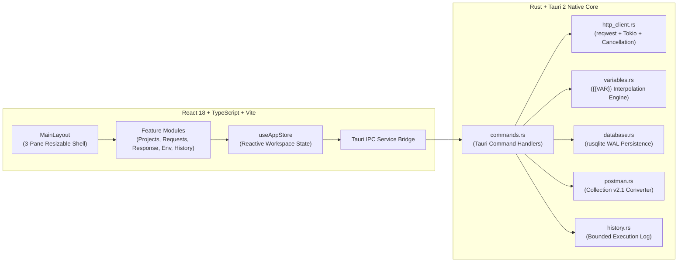

<div align="center">
  

  # Reqly

  **A Minimal, Native, Ultra-Fast Desktop REST API Client Built with Rust & Tauri 2**

  [](https://www.rust-lang.org/)
  [](https://v2.tauri.app/)
  [](https://react.dev/)
  [](https://www.typescriptlang.org/)
  [](https://www.sqlite.org/)
  [](https://schema.getpostman.com/json/collection/v2.1.0/collection.json)
</div>

---

## Overview

**Reqly** ([`github.com/iam-febriansyah/reqly`](https://github.com/iam-febriansyah/reqly)) is a lightweight desktop REST API client inspired by Postman, engineered from the ground up in **Rust** and **Tauri 2** for instant startup, minimal RAM usage, native desktop responsiveness, and complete offline-first privacy.

Instead of bundling a heavy Chromium + Node.js Electron runtime, Reqly executes all HTTP requests, variable interpolations, SQLite persistence, and Postman Collection v2.1 conversions natively in compiled Rust while presenting a clean, information-dense interface built on **Apple Human Interface & Fluid Design Principles**.

### Why Reqly?

| Metric / Capability | Traditional Electron API Clients | **Reqly (Rust + Tauri 2)** |
| :--- | :--- | :--- |
| **Installer Size** | ~180 MB – 300 MB | **~3.7 MB** (`Reqly_1.0.0_x64-setup.exe`) |
| **Cold Startup Time** | 3 – 8 seconds | **< 250 ms** |
| **Data Storage** | Mandatory cloud sync / login prompts | **100% Local SQLite (`WAL` mode)** |
| **Account / Telemetry** | Required for collections & environments | **Zero accounts, zero telemetry** |
| **Postman Compatibility** | Native | **Bidirectional Postman Collection v2.1 JSON** |

---

## Core Features

### 1. Full-Featured HTTP Request Builder
- **HTTP Methods**: Built-in support for `GET`, `POST`, `PUT`, `PATCH`, `DELETE`, `HEAD`, `OPTIONS`, plus **custom HTTP methods** (e.g., `PROPFIND`, `PURGE`, `LINK`, `LOCK`).
- **URL & Query Parameters**:
  - Automatic URL normalization and query parameter encoding.
  - Enable/disable individual query parameters without deleting them.
  - Dynamic `{{VARIABLE_NAME}}` interpolation with a live **Resolved URL** preview bar.
- **Request Headers**:
  - Add, edit, toggle (`enable`/`disable`), and delete headers.
  - Smart `Content-Type` management that respects user-defined headers and prevents duplicate header injection.
- **Request Body Modes**:
  - `None`: Clean bodiless request execution.
  - `JSON`: Built-in syntax-highlighted code editor with line numbers, live JSON validation indicator, **Prettify** (`Ctrl+Shift+F`), and **Minify**.
  - `Raw Text`: UTF-8 plain text payloads.
  - `Form URL Encoded`: Key-value table encoded as `application/x-www-form-urlencoded`.
  - `Multipart Form Data`: Supports both text fields and local file uploads (`multipart/form-data`).
- **Authentication**:
  - `No Auth`
  - `Bearer Token` (`Authorization: Bearer <token>`)
  - `Basic Auth` (`Authorization: Basic <base64(username:password)>`)
  - `API Key` (injectable into either **HTTP Header** or **Query Parameter**)
  - Full `{{VARIABLE_NAME}}` support inside all authentication fields.
- **Timeouts & Cancellation**:
  - Configurable per-request timeout in milliseconds (default `30,000 ms`).
  - Instant in-flight request cancellation powered by `tokio::sync::watch` channels in Rust.

### 2. Clean & Readable Response Viewer
- **Real-Time Telemetry**: Displays HTTP status code with semantic color coding (`2xx`, `3xx`, `4xx`, `5xx`), elapsed response time (`ms`), and payload size (`B` / `KB` / `MB`).
- **Multi-Format Body Inspection**:
  - **Pretty JSON**: Syntax-highlighted, auto-indented JSON viewer.
  - **Raw**: Exact unformatted UTF-8 response payload.
  - **HTML / XML**: Clean source inspection for markup responses.
  - **Image Preview**: Automatic detection of binary `image/*` responses rendered via Base64 data URIs.
- **Developer Controls**: One-click **Copy Body**, **Copy Headers**, **Format JSON**, and **Clear Response**.

### 3. Independent Projects & Folder Hierarchy
```text
Project (e.g. Core Platform API)
 ├── Folder: Users
 │    ├── GET  Get User Profile
 │    └── POST Create User
 ├── Folder: Posts
 │    └── GET  List Posts
 └── Ungrouped Requests
      └── DELETE Revoke Session
```
- Create, rename, and delete independent projects.
- Organize requests into folders (`Create`, `Rename`, `Delete` folders).
- Move requests between folders or to the project root.
- Duplicate, rename (via menu or double-click), and reorder requests (`Move Up` / `Move Down`).
- Instant real-time filtering by request name, URL, or HTTP method (`Ctrl+K`).
- Debounced auto-save directly to local SQLite.

### 4. Environment Variable Manager (`{{VARIABLE_NAME}}`)
- Create multiple environments per project (e.g., `Development`, `Staging`, `Production`).
- Add, edit, enable/disable, and delete variables.
- Switch active environments from the top toolbar or sidebar selector.
- **Non-Destructive Resolution**: Variables (`{{BASE_URL}}`, `{{API_TOKEN}}`, `{{USER_ID}}`) are resolved dynamically in Rust immediately before sending—never overwriting your saved request templates.
- **Unresolved Variable Detection**: Clearly warns when a request references an undefined or disabled `{{VARIABLE}}`.

### 5. Lightweight Request History
- Automatically records every executed request with HTTP method, resolved URL, status code, duration (`ms`), and timestamp.
- Click any historical entry to immediately reopen its full request snapshot in the workspace.
- Bounded per-project storage (retains the latest 150 entries per project and omits bulky response bodies from disk) to keep database size minimal.

### 6. Postman Collection v2.1 Import & Export
- **Export**: Converts any Reqly project—including folder hierarchy, requests, query parameters, headers, body modes, authentication, and active environment variables—into a standards-compliant **Postman Collection v2.1.0 JSON** file (`https://schema.getpostman.com/json/collection/v2.1.0/collection.json`) that imports directly into Postman without manual edits.
- **Import**: Parses any `.postman_collection.json` file or pasted JSON into a new independent Reqly project, preserving nested folders, request configurations, and collection variables.

---

## UI / UX — Apple Fluid Design Principles

Reqly's interface is crafted following Apple's Human Interface Guidelines and WWDC *Designing Fluid Interfaces* principles:
- **Immediate Press Feedback**: Controls respond on pointer-down (`transform: scale(0.97)` on `:active`), eliminating input latency.
- **1:1 Direct Manipulation Splitters**: Both the Project Explorer sidebar and the Request/Response split pane use `PointerEvents` with `setPointerCapture` and grab-offset tracking for zero-lag resizing.
- **Translucent Chrome & Materials**: Top utility bar and modal sheets use `backdrop-filter: blur(20px) saturate(180%)` with 1px hairline borders.
- **Optical Typography & Tabular Metrics**: Native platform font stack with size-specific letter tracking and `tabular-nums` alignment on status codes, latencies, and payload sizes.
- **Adaptive Appearance & Accessibility**: Full support for **Light**, **Dark**, and **System** themes, as well as `@media (prefers-reduced-motion: reduce)` and `@media (prefers-reduced-transparency: reduce)`.

---

## Architecture & Project Structure



### Directory Layout

```text
reqly/
├── public/
│   ├── logo.svg                    # Master vector brand mark ("The Duplex R")
│   └── app-icon-1024.png           # 1024x1024 master app icon
├── scripts/
│   └── tauri.cjs                   # Cross-shell Tauri CLI wrapper (auto-detects ~/.cargo/bin)
├── src/                            # React + TypeScript Frontend
│   ├── components/
│   │   ├── JsonCodeEditor.tsx      # Syntax-highlighted JSON/Raw editor with Prettify/Minify
│   │   ├── KeyValueTable.tsx       # Params, Headers & URL-Encoded editor with variable hints
│   │   ├── MethodBadge.tsx         # Semantic HTTP method pill component
│   │   └── Modal.tsx               # Translucent Apple sheet modal
│   ├── features/
│   │   ├── environments/
│   │   │   └── EnvironmentManagerModal.tsx
│   │   ├── history/
│   │   │   └── HistoryList.tsx
│   │   ├── projects/
│   │   │   ├── PostmanModal.tsx
│   │   │   └── ProjectExplorer.tsx
│   │   ├── requests/
│   │   │   └── RequestEditor.tsx
│   │   └── response/
│   │       └── ResponseViewer.tsx
│   ├── layouts/
│   │   └── MainLayout.tsx          # 3-pane resizable desktop workspace & global shortcuts
│   ├── services/
│   │   └── api.ts                  # Typed Tauri invoke bridge + browser dev fallback
│   ├── stores/
│   │   └── useAppStore.tsx         # Central state store & debounced persistence
│   ├── styles/
│   │   └── apple.css               # Apple HIG design tokens, themes & motion rules
│   ├── types/
│   │   └── index.ts                # Shared TypeScript interfaces
│   ├── App.tsx
│   └── main.tsx
├── src-tauri/                      # Rust Backend
│   ├── capabilities/
│   │   └── default.json            # Tauri 2 security capability permissions
│   ├── icons/                      # Generated ICO, ICNS, PNG & Appx desktop icons
│   ├── src/
│   │   ├── commands.rs             # #[tauri::command] IPC endpoints
│   │   ├── database.rs             # SQLite schema initialization, migrations & CRUD
│   │   ├── history.rs              # Bounded history recording & pruning
│   │   ├── http_client.rs          # Async reqwest executor, auth, multipart & cancellation
│   │   ├── lib.rs                  # Tauri application builder & state registration
│   │   ├── main.rs                 # Native desktop entry point
│   │   ├── models.rs               # Serde data models
│   │   ├── postman.rs              # Postman Collection v2.1 import/export engine
│   │   └── variables.rs            # {{VARIABLE}} parser & non-destructive resolver
│   ├── build.rs
│   ├── Cargo.toml
│   └── tauri.conf.json
├── index.html
├── package.json
├── tsconfig.json
└── vite.config.ts
```

---

## SQLite Database Schema

All data is stored locally in `reqly.db` inside the OS application data directory (`%APPDATA%\com.reqly.desktop\reqly.db` on Windows, `~/Library/Application Support/com.reqly.desktop/reqly.db` on macOS, `~/.local/share/com.reqly.desktop/reqly.db` on Linux):

- **`projects`**: `id`, `name`, `description`, `active_environment_id`, `created_at`, `updated_at`
- **`folders`**: `id`, `project_id`, `parent_id`, `name`, `sort_order`, `created_at`
- **`requests`**: `id`, `project_id`, `folder_id`, `name`, `method`, `url`, `params_json`, `headers_json`, `body_json`, `auth_json`, `timeout_ms`, `sort_order`, `created_at`, `updated_at`
- **`environments`**: `id`, `project_id`, `name`, `variables_json`, `created_at`, `updated_at`
- **`history`**: `id`, `project_id`, `method`, `url`, `status_code`, `duration_ms`, `response_size`, `timestamp`, `request_snapshot_json`

---

## Keyboard Shortcuts

| Action | Windows / Linux | macOS |
| :--- | :--- | :--- |
| **Send HTTP Request** | `Ctrl + Enter` | `Cmd + Enter` |
| **New HTTP Request** | `Ctrl + N` | `Cmd + N` |
| **Search / Filter Requests** | `Ctrl + K` | `Cmd + K` |
| **Open Environment Manager** | `Ctrl + E` | `Cmd + E` |
| **Postman v2.1 Import / Export** | `Ctrl + I` | `Cmd + I` |
| **Prettify JSON Body** | `Ctrl + Shift + F` | `Cmd + Shift + F` |
| **Close Active Modal** | `Esc` | `Esc` |

---

## Getting Started

### Prerequisites

1. **Node.js** `v18+` (`v20+` or `v24+` recommended) and `npm`
2. **Rust Toolchain (`rustc` & `cargo`)**:
   - **macOS (MacBook) & Linux**:
     ```bash
     curl --proto '=https' --tlsv1.2 -sSf https://sh.rustup.rs | sh -s -- -y
     source "$HOME/.cargo/env"
     ```
   - **Windows (PowerShell)**:
     ```powershell
     Invoke-WebRequest -Uri "https://win.rustup.rs/x86_64" -OutFile "$env:TEMP\rustup-init.exe"
     & "$env:TEMP\rustup-init.exe" -y
     $env:Path += ";$env:USERPROFILE\.cargo\bin"
     ```
3. **Platform Build Dependencies**:
   - **macOS**: Xcode Command Line Tools
     ```bash
     xcode-select --install
     ```
   - **Windows**: Microsoft Visual Studio C++ Build Tools & WebView2 (pre-installed on Windows 10/11)
   - **Linux (Ubuntu/Debian)**:
     ```bash
     sudo apt-get update
     sudo apt-get install -y libwebkit2gtk-4.1-dev build-essential curl wget file libssl-dev libayatana-appindicator3-dev librsvg2-dev patchelf
     ```

### Installation & Development

```bash
# 1. Clone the repository
git clone https://github.com/iam-febriansyah/reqly.git
cd reqly

# 2. Install frontend dependencies
npm install

# 3. Launch Reqly in native Tauri development mode (with hot reload)
npm run tauri dev
```

### Running Tests

```bash
# Run Rust unit & integration tests (variables, Postman v2.1 roundtrip, HTTP client, SQLite persistence)
cd src-tauri
cargo test
```

### Building Production Installers (`.exe` / `.msi` / `.dmg` / `.AppImage`)

```bash
# Build optimized release binary & OS installers
npm run tauri build
```

#### Output Locations by OS

- **Windows**:
  - **NSIS Installer (`.exe`)**: `src-tauri/target/release/bundle/nsis/Reqly_1.0.0_x64-setup.exe`
  - **MSI Installer (`.msi`)**: `src-tauri/target/release/bundle/msi/Reqly_1.0.0_x64_en-US.msi`
  - **Portable Executable (`.exe`)**: `src-tauri/target/release/reqly.exe`
- **macOS (MacBook Apple Silicon & Intel)**:
  - **DMG Disk Image (`.dmg`)**: `src-tauri/target/release/bundle/dmg/Reqly_1.0.0_aarch64.dmg` (or `x64.dmg`)
  - **macOS Application Bundle (`.app`)**: `src-tauri/target/release/bundle/macos/Reqly.app`
- **Linux**:
  - **AppImage**: `src-tauri/target/release/bundle/appimage/Reqly_1.0.0_amd64.AppImage`
  - **Debian Package (`.deb`)**: `src-tauri/target/release/bundle/deb/Reqly_1.0.0_amd64.deb`

---

## Troubleshooting

### `failed to run 'cargo metadata' command ...: program not found`

This error occurs when the Rust compiler (`cargo`) is either not installed yet or not loaded into your current terminal session's `PATH`.

- **Fix on macOS (MacBook) / Linux**:
  ```bash
  # Install Rust if not installed yet
  curl --proto '=https' --tlsv1.2 -sSf https://sh.rustup.rs | sh -s -- -y

  # Load Cargo into current terminal session
  source "$HOME/.cargo/env"
  cargo --version

  # Run Reqly
  npm run tauri dev
  ```
- **Fix on Windows (PowerShell)**:
  ```powershell
  # Add Cargo bin directory to current PowerShell session PATH
  $env:Path += ";$env:USERPROFILE\.cargo\bin"
  cargo --version

  # Always use `npm run tauri` (uses scripts/tauri.cjs wrapper)
  npm run tauri dev
  ```

---

## Security & Reliability

- **Secret Redaction**: Authorization headers, Bearer tokens, Basic credentials, and API keys are never logged or leaked into error messages.
- **Non-Blocking Async Execution**: All network I/O and multipart file reads run on Tokio background tasks so the UI remains responsive at 60/120 fps even during slow or large responses.
- **Offline-First Guarantee**: Reqly requires zero internet connectivity to open projects, edit requests, manage environments, or import/export Postman collections.

---

## License

MIT License © [Febriansyah](https://github.com/iam-febriansyah)
